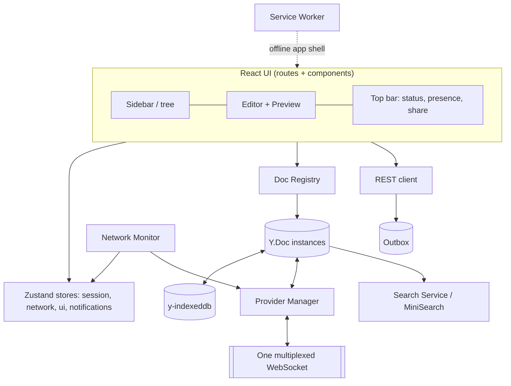
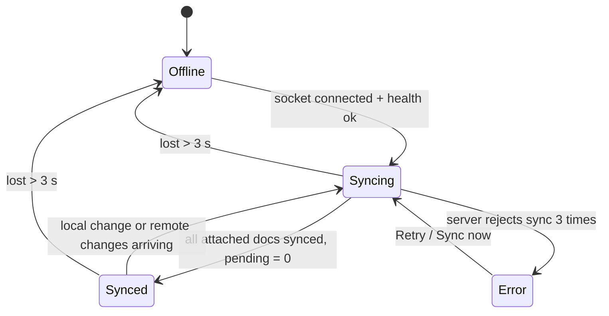

# SyncScribe — Frontend Plan (FP)

Built from `SyncScribe-PRD.md` (features A1–J4, workflows 4.2–4.12, flows DF1–DF16, edge cases EC1–EC41) and `TOOLS_AND_TECHNOLOGIES.md`. Backend counterpart: `BACKEND_PLAN.md` (BP).

Current workspace state: no code yet; only `docs/`. Everything below is to be built.

Section IDs (FP-1, FP-2…) are referenced from the traceability matrix at the end (FP-20), which maps **every** PRD feature and edge case to where it is built.

---

## FP-1. Goals and constraints for the frontend

- The browser app is the product. All editing, organizing, search, history viewing and export run in the browser and work offline.
- The device is the source of truth for the user: every change goes to Yjs → IndexedDB **before** anything touches the network.
- The server is used only for: auth, permissions, relaying/storing CRDT updates, versions, notifications.
- Zero paid tools. Deadline: 2 days → build **Must** first (FP-19), then Should, then Could.

---

## FP-2. Repository layout (monorepo)

```
SyncScribe/
├── package.json                  # npm workspaces: apps/*, packages/*
├── docs/                         # PRD, Tools, FP, BP
├── packages/
│   └── shared/                   # shared by web + server
│       └── src/
│           ├── roles.ts          # Role enum + capability helpers
│           ├── schemas.ts        # Zod request/response schemas
│           ├── ydoc-keys.ts      # Yjs doc names + field keys (single source of truth)
│           └── types.ts          # User, Workspace, Share, Version, Notification…
├── apps/
│   ├── server/                   # see BACKEND_PLAN.md
│   └── web/
│       ├── index.html
│       ├── vite.config.ts        # React + vite-plugin-pwa
│       ├── tailwind.config.ts
│       ├── public/               # icons, manifest assets
│       └── src/
│           ├── main.tsx
│           ├── App.tsx           # router + providers
│           ├── routes/           # screens (FP-6)
│           ├── components/       # UI components (FP-7)
│           ├── editor/           # CodeMirror setup + extensions (FP-9)
│           ├── crdt/             # Yjs doc registry, persistence, tree logic (FP-4, FP-8)
│           ├── sync/             # provider manager, network monitor, status (FP-10)
│           ├── stores/           # Zustand stores (FP-5)
│           ├── services/         # REST client, outbox, search, export, storage (FP-11…FP-15)
│           ├── lib/              # utils: ids, dates, markdown helpers
│           └── test/             # Vitest unit tests
│       └── e2e/                  # Playwright tests (FP-18)
```

Scripts (root): `npm run dev` (web + server together), `npm run build`, `npm test`, `npm run e2e`.

---

## FP-3. Frontend architecture



Layers and rules:

1. **CRDT layer (`crdt/`)** — owns all Y.Docs. Nothing else creates a Y.Doc.
2. **Sync layer (`sync/`)** — attaches/detaches network providers to Y.Docs; never edits content.
3. **Stores (`stores/`)** — UI and status state only; document data stays in Yjs.
4. **Services (`services/`)** — REST, outbox, search, export, storage checks.
5. **UI** — React components subscribe to Yjs (via small hooks) and stores.

---

## FP-4. Local data model (Yjs documents)

All names are defined once in `packages/shared/src/ydoc-keys.ts`. IDs are random (`nanoid`, 21 chars).

### FP-4.1 Document list

| Y.Doc name | Purpose | Who can write |
| --- | --- | --- |
| `ws:{workspaceId}` | Folder/document **tree** of one workspace + workspace templates | Workspace Owner/Editor members |
| `doc:{docId}` | One document: text, title, images | Owner / Editor of the doc |
| `cm:{docId}` | Comments for one document | Owner / Editor / Commenter |
| `user:{userId}` | Per-user prefs: pins, recents, theme, editor mode | That user only (all their devices) |

Comments are a separate Y.Doc so the server can give Commenters **write** access to comments while their `doc:` connection stays read-only (G2, G5).

### FP-4.2 `ws:{workspaceId}` structure

```
Y.Map "items"   : itemId -> Y.Map {
    type: "folder" | "doc",
    name: string,              // folders only (doc titles live in doc:{id}.meta.title)
    parentId: string | null,   // null = workspace root
    order: string,             // fractional index for manual ordering
    tags: Y.Array<string>,     // docs only (B7)
    createdAt: number, createdBy: userId,
    deletedAt: number | null,  // set = in Trash (B10)
    deletedBy: userId | null,
    trashParentId: string | null // original parent, for restore
}
Y.Map "templates" : templateId -> { name, content }      // C14 save-as-template
Y.Map "info"      : { name, kind: "personal" | "team" }
```

- **Move (B5):** set `parentId` (and `order`). Y.Map uses a deterministic last-writer rule per key, so two concurrent moves end with the **same** single parent on every device (EC11). An item is never duplicated because it exists exactly once in `items`.
- **Rename folder:** set `name` — concurrent renames converge to one value on all devices (EC10).
- **Delete (B10, EC9):** set `deletedAt` / `deletedBy` / `trashParentId`; content docs are untouched.

### FP-4.3 `doc:{docId}` structure

```
Y.Text "content"   // markdown source
Y.Map  "meta"      : { title, createdAt, createdBy, workspaceId }
Y.Map  "assets"    : assetId -> { mime, name, size, data: Uint8Array }   // images (C10)
```

- Title in `meta.title` so users who only have the document shared (not the workspace) still see it; concurrent renames converge (EC10, C8).
- Images live inside the doc as binary, so they are available offline and sync with the doc. Markdown references them as ``. Limit 2 MB per image, types png/jpeg/gif/webp (EC34).

### FP-4.4 `cm:{docId}` structure

```
Y.Map "threads" : threadId -> Y.Map {
    anchorStart: RelativePosition (encoded), anchorEnd: RelativePosition,
    quote: string, resolved: boolean, createdBy, createdAt,
    replies: Y.Array<{ id, body, authorId, createdAt, mentions: userId[] }>
}
```

Relative positions keep each comment attached to its text while others edit.

### FP-4.5 `user:{userId}` structure

```
Y.Array "pins"     : itemId[]               // B8
Y.Array "recents"  : { docId, openedAt }[]  // B9 (max 20)
Y.Map   "settings" : { theme, editorMode, focusMode, sort }   // C3, C15, B6
```

### FP-4.6 Tree resolution (pure function, unit-tested)

`resolveTree(items) -> TreeNode[]` runs on every tree change and is deterministic on all devices:

1. Skip items with `deletedAt` (they appear in Trash view).
2. If `parentId` points to a missing or deleted folder → show item at root (EC13 display rule).
3. **Cycle breaking (EC12):** walk each item's ancestor chain; if it loops, the item in the loop with the **smallest id** is treated as a child of root. Every device computes the same answer. The client that *created* the cycle (detects its own last move participates) writes the fix (`parentId = null` for that item) and shows a notice: "Folder moves conflicted; 'X' was moved to the top level".
4. Sort children: user-chosen sort from settings (name / last edited / created) or manual `order` (B6).

### FP-4.7 Local non-CRDT stores (idb-keyval, keys prefixed by userId — EC21)

| Key | Content | Used for |
| --- | --- | --- |
| `session` | `{ user, token, tokenExp, workspaces[] }` | Offline sign-in (A3), boot |
| `{uid}:pending` | `Record<docName, { since: number }>` | Pending markers + count (D4, E6) |
| `{uid}:outbox` | ordered list of REST actions | Offline invites, mentions (DF10, F5) |
| `{uid}:revoked` | doc IDs whose access was removed | EC16 handling |
| `{uid}:offlineSet` | doc IDs fully downloaded | D6 indicator |

---

## FP-5. Client state (Zustand stores)

| Store | State | Updated by |
| --- | --- | --- |
| `sessionStore` | `user`, `token`, `status: signedOut | signedIn | needsReauth`, `workspaces`, `activeWorkspaceId` | Auth screens, token refresh, 401 handler |
| `networkStore` | `browserOnline`, `serverReachable`, `socketStatus`, derived `syncState: online | offline | syncing | synced | error`, `pendingCount`, `lastSyncedAt`, `errorReason` | Network Monitor, Provider Manager |
| `docStatusStore` | per doc: `pending`, `synced`, `role`, `revoked`, `offlineAvailable` | Provider Manager |
| `uiStore` | sidebar open, editor mode, focus mode, modals, toasts | Components |
| `notificationStore` | in-app notifications + unread count | REST poll, socket stateless messages, local events |
| `presenceStore` | awareness states for open doc | Provider awareness |

---

## FP-6. Screens and routes

| Route | Screen | Online required? | PRD |
| --- | --- | --- | --- |
| `/signup` | Sign up: name, email, password (≥ 8), validation | Yes | A1, 4.2 |
| `/login` | Sign in; "Forgot password" link | Yes (first time) | A2 |
| `/forgot`, `/reset/:token` | Request / set new password | Yes | A5 |
| `/` | Workspace home: sidebar + recent docs + empty state | No | B1, B9 |
| `/doc/:docId` | Editor screen (FP-9) | No | C1–C15, F1–F4 |
| `/doc/:docId/history` | Version history panel/route | Yes for server versions | H1–H4 |
| `/trash` | Trash list: restore / delete permanently | No (permanent delete queued until online) | B10 |
| `/shared` | Shared with me | Cached list offline | G1 |
| `/search` (also Cmd+K overlay) | Search results | No | I1, I2 |
| `/settings` | Profile, theme, storage usage, sign out, clear local data | Partly | A4, D7, C15 |
| `/workspaces/:id/members` | Team workspace members | Yes | B2 |
| `/s/:token` | Accept share link | Yes | G3 |
| `*` | Not found | No | — |

Route guard: if `session` exists in idb-keyval → allow app routes even offline (A3). If not and offline → "Connect once to set up SyncScribe" screen (EC4).

---

## FP-7. Component inventory

**Layout**
- `AppShell` — sidebar + top bar + main + toasts.
- `TopBar` — breadcrumb, `SyncStatusBadge`, `PresenceAvatars`, `ShareButton`, `NotificationBell`, `UserMenu`.
- `StatusBar` (bottom of editor) — "Saved on this device" / "Synced", word count, reading time (C12).
- `OfflineBanner` — non-blocking banner on going offline (4.4 step 2).
- `Toaster` — brief notices ("All changes synced", errors).

**Sidebar (B3–B9)**
- `WorkspaceSwitcher` (B2), `NewMenu` (doc / folder / from template), `TreeView` + `TreeNode` (expand/collapse, drag-and-drop with `@dnd-kit/core` — MIT, free), `PinnedSection`, `RecentSection`, `TagFilter`, `SortMenu`, `PendingDot` (D4), `OfflineAvailableIcon` (D6), `TrashLink`, context menu (rename, move to…, duplicate, pin, tags, delete, export).

**Editor (C, F)**
- `DocTitle` (inline rename), `EditorToolbar` (C4), `MarkdownEditor` (CodeMirror), `MarkdownPreview`, `ModeSwitch` (edit / split / preview — C3), `TableOfContents` (C13), `FindReplace` (CodeMirror search panel — C11), `CommentsPanel` + `CommentThread` + `MentionInput` (F4, F5), `ReadOnlyBanner` (viewer/commenter — G5), `DocDeletedBanner` (EC9), `RevokedBanner` (EC16).

**Dialogs**
- `ShareDialog` (invite by email + role, link create/revoke, manage access list — G1–G4).
- `MoveToDialog` (B5), `TemplatePicker` (C14), `ImportDialog` (J1), `ExportMenu` (J2), `SignOutDialog` (EC20), `ConfirmDialog`, `StorageWarningDialog` (EC24, EC25), `UpdateAvailableToast` (EC30), `ReauthModal` (EC19).

**Onboarding**
- `WelcomeTour` (3 steps) and auto-created Welcome document (J4).

---

## FP-8. CRDT layer details (`crdt/`)

### FP-8.1 Doc Registry

```ts
getDoc(name: string): Promise<Y.Doc>   // create or reuse; attaches IndexedDB persistence; resolves when local state loaded
releaseDoc(name: string): void         // ref-counted; destroys when unused (except ws:/user: docs, kept open)
```

- Each Y.Doc gets `new IndexeddbPersistence(`${userId}:${name}`, ydoc)` — IndexedDB database names prefixed with the user id so accounts on a shared device never see each other's data (EC21).
- Resolves after `persistence.whenSynced` → document opens from disk instantly, offline (D1, D3, US2).
- On every local update (origin ≠ provider): mark pending in `{uid}:pending` (D4) → `PendingDot` appears.

### FP-8.2 Workspace operations (`crdt/tree.ts`)

`createDoc(parentId, template?)`, `createFolder(parentId, name)`, `rename(itemId, name)`, `move(itemId, newParentId, order)`, `trash(itemId)`, `restore(itemId)`, `purge(itemId)` (Owner only), `duplicate(docId)`, `setTags(docId, tags)`.

- All operations are single `ydoc.transact()` calls, so they are atomic and work offline.
- `createDoc` writes the tree item and the new `doc:{id}` meta in one user action, then navigates to it with the cursor in the title (4.3 step 2).
- `restore` puts the item back under `trashParentId` if that folder still exists and is not deleted, otherwise at root (4.10 step 3).
- `trash(folder)` also marks every descendant with the same `deletedAt` so they restore together.

### FP-8.3 Edge rules enforced in the CRDT layer

| Case | Rule |
| --- | --- |
| EC9 — doc deleted remotely while I edit | Content still accepted (doc Y.Doc untouched). When the tree shows my open doc became `deletedAt != null`, show `DocDeletedBanner`: "This document was deleted by {name}" + **Restore** button. |
| EC13 — I edit a doc inside a folder deleted by someone else | When my pending edits to a doc sync and its ancestor is in Trash, auto-move the doc to root (`parentId = null`, clear `deletedAt`) and notify "Moved to top level because its folder was deleted". |
| EC12 — folder cycle | `resolveTree` cycle breaking (FP-4.6). |
| EC36 — empty title | Display "Untitled"; duplicates allowed. |

---

## FP-9. Editor (`editor/`)

### FP-9.1 CodeMirror setup

Extensions:
- `markdown({ codeLanguages })` + GFM — syntax for headings, bold, italic, lists, task lists, links, quotes, code, tables, rules (C2).
- `yCollab(ytext, provider.awareness, { undoManager })` from `y-codemirror.next` — CRDT binding + remote cursors with name labels and colours (F1, F3).
- `Y.UndoManager(ytext, { trackedOrigins: new Set([localOrigin]) })` — undo/redo only my changes (C7, EC14).
- `search()` + `searchKeymap` — find & replace (C11).
- `EditorState.readOnly.of(role in [viewer, commenter] || revoked)` — read-only enforcement in the UI (G5, EC18). (Server also rejects writes — BP.)
- `lineWrapping`, `history` is **not** used (UndoManager replaces it).
- Paste handler: images → asset store (C10); text over 1 MB → toast "Paste is larger than the 1 MB limit" and cancel (EC32).
- Drop handler: image files → asset store.

### FP-9.2 Toolbar and shortcuts (C4, C5)

| Action | Toolbar | Shortcut |
| --- | --- | --- |
| Bold / italic / strikethrough | yes | Cmd+B / Cmd+I / Cmd+Shift+X |
| Heading 1–3 | yes | Cmd+Alt+1..3 |
| Bullet / numbered / task list | yes | Cmd+Shift+8 / 7 / 9 |
| Link / image / code block / quote / table / rule | yes | Cmd+K (link in editor) … |
| Toggle preview mode | yes | Cmd+Shift+P |
| New document | sidebar | Cmd+Alt+N |
| Search all docs / quick open | top bar | Cmd+P (quick open), Cmd+Shift+F (search) |
| Find / replace in doc | — | Cmd+F / Cmd+Alt+F |

Toolbar buttons insert markdown around the selection via CodeMirror transactions (so they are ordinary CRDT edits).

### FP-9.3 Preview (C3)

- `react-markdown` + `remark-gfm` + `rehype-sanitize` + `rehype-highlight`.
- Custom `img` renderer resolves `asset:{id}` to an object URL from the doc's `assets` map; missing asset → placeholder (EC38).
- Re-render debounced 150 ms; for docs > 50,000 words, 500 ms (EC31).
- Rendering errors are caught by an error boundary that shows raw text instead (EC33).
- Modes: edit / split / preview, saved per user in `user:{id}.settings` (C3).

### FP-9.4 Extras

- **Word count & reading time** (C12): computed from `Y.Text` on change (debounced), 200 wpm.
- **Table of contents** (C13): parse headings from text; click → scroll editor/preview.
- **Focus mode & themes** (C15): hide sidebar and toolbar; Tailwind `dark` class from setting or OS.
- **Templates** (C14): built-ins in `lib/templates.ts` (Meeting notes, Report, To-do); "Save as template" writes current content into `ws.templates`.
- **Duplicate** (C9): new doc id, copies text, title "Copy of …", assets.

---

## FP-10. Sync layer (`sync/`)

### FP-10.1 Provider Manager

- Creates **one** `HocuspocusProviderWebsocket` (shared socket, multiplexing) with URL from env and auth token from `sessionStore`.
- `attach(name)` → `new HocuspocusProvider({ websocketProvider, name, document: ydoc, token })`; `detach(name)`.
- Always attached while signed in: `user:{uid}`, every `ws:{id}` the user belongs to.
- Attached on demand: the open `doc:` and `cm:` docs.
- **Background sync of non-open docs (E2):** on connect/reconnect, attach every doc in `{uid}:pending` (to upload) and every doc the server reports changed since `lastSyncedAt` (REST `GET /api/sync/changed?since=` — BP) to download; process with concurrency 4; detach when `synced` and no unsynced changes. Progress shown as "Syncing 12 of 40…" for big syncs (EC5).
- Clear pending flag for a doc when provider emits `synced` **and** `unsyncedChanges === 0` → `PendingDot` disappears; when global count reaches 0 → toast "All changes synced" (4.4 step 7).
- `broadcast: true` (default) shares updates and awareness across tabs on the same device, even offline (EC28, DF16).
- On new device sign-in (A6, DF13, US17): attach all workspace docs and every doc in the tree, download, mark them in `{uid}:offlineSet` (D6).

### FP-10.2 Handling server responses

| Event from provider | Frontend reaction | PRD |
| --- | --- | --- |
| `authenticated` with scope `readonly` | `docStatus.role` = viewer/commenter → editor read-only, `ReadOnlyBanner` | G5, EC17 |
| `authenticationFailed` reason `token-expired` | `sessionStore.status = needsReauth` → `ReauthModal`; keep working offline; pending kept; after sign-in, reconnect and sync | EC19 |
| `authenticationFailed` reason `forbidden` | Add doc to `{uid}:revoked`; `RevokedBanner`: "Your access was removed" + **Export my local copy** button; doc removed from sidebar; local IndexedDB copy deleted after export or dismiss | EC16, 4.8 step 5, DF11 |
| `close` / `disconnect` | Network Monitor re-evaluates | E1 |
| stateless message `{type:"notification"}` | Push to `notificationStore` | J3 |
| stateless message `{type:"role-changed"}` | Reconnect that doc to refresh scope | EC17 |

### FP-10.3 Network Monitor (`sync/network.ts`)

Inputs: `window` `online`/`offline` events, provider socket status, `GET /api/health` ping every 15 s while the browser says online (and immediately on `online` event).



- **Debounce (EC2):** a connection loss must last 3 s before the UI shows Offline, so the badge does not flicker.
- **"Online but unreachable" (EC3):** browser online but health check fails or times out (5 s) → Offline with label "Can't reach SyncScribe — working offline".
- **Reconnect backoff:** provider's built-in exponential backoff (1 s → max 30 s); **Sync now** (E7) forces immediate reconnect + health check.
- **Slow network (EC6):** editing never waits on the network; badge stays "Syncing" until done.
- `SyncStatusBadge` shows: Online · Offline · Syncing · Synced · Sync error (with reason + Retry) and the pending count "3 unsynced" (E5, E6).
- Per-document status: `PendingDot` in the sidebar and status bar text in the editor.

### FP-10.4 Presence (F2, F3)

- On attach of the open doc, set awareness `{ user: { id, name, color } , cursor }`.
- `PresenceAvatars` lists awareness states (dedup by user id); a user whose state disappears shows as gone; when I am offline, my avatar shows an offline ring locally (4.6 step 5).
- Colours come from the user's profile colour (A4).

### FP-10.5 Sync while closed (E8, Could)

- On `visibilitychange` → hidden and `pagehide`: flush — wait up to 2 s for the provider to send pending updates.
- Because live sync uses a WebSocket in the page, true background sync after close is not possible in all browsers; data is never lost because it is already in IndexedDB and will sync on next open. Documented limitation.

---

## FP-11. Auth and session (frontend side)

- **Sign up / sign in (A1, A2):** forms validated with shared Zod schemas; on success store `{user, token, tokenExp, workspaces}` in idb-keyval `session` and Zustand.
- **Offline boot (A3):** on start, read `session`; if present, render the app immediately regardless of network or token expiry. Token is only needed when connecting.
- **Token refresh:** access token lifetime 7 days; on reconnect, if < 1 day left, call `POST /api/auth/refresh`. If expired → `needsReauth` (EC19).
- **Sign out (A2, EC20):** if `pendingCount > 0`, `SignOutDialog` lists unsynced docs with options *Sync first* (wait for synced, then sign out) / *Sign out and keep data on this device* / *Cancel*. A separate **Sign out and clear this device** option deletes all `${uid}:*` IndexedDB databases and idb-keyval keys.
- **Shared devices (EC21):** all local storage namespaced by user id; on sign-in of a different user, nothing from the previous user is loaded.
- **Profile (A4):** name, initials avatar, cursor colour (palette of 8) → `PATCH /api/me`.
- **Password reset (A5):** `/forgot` → `POST /api/auth/forgot`; `/reset/:token` → `POST /api/auth/reset`. Offline → explain it needs a connection.

---

## FP-12. Sharing, permissions and workspaces (frontend side)

- `ShareDialog` (G1–G4):
  - Invite: email + role (Editor / Commenter / Viewer) → `POST /api/shares`. Offline → action goes to **outbox** with the message "Invitation will be sent when you're back online" (4.8 offline rule).
  - Share link: choose role → `POST /api/share-links`; copy; revoke → `DELETE /api/share-links/:id` (G3).
  - Manage access: list from `GET /api/shares?resource=` with role dropdowns and remove buttons (Owner only) (G4).
- Capability checks via `packages/shared/roles.ts` (`can(role, "edit" | "comment" | "share" | "purge")`) hide/disable controls by role (Editor can invite up to Editor; only Owner purges).
- `/shared` lists `GET /api/shared-with-me` (cached in idb-keyval for offline display) (4.8 step 3).
- `/s/:token` → `POST /api/share-links/:token/accept` → navigate to doc (G3, EC23 shows "This link is no longer active").
- Team workspaces (B2): create (`POST /api/workspaces`), invite members (`POST /api/workspaces/:id/members`), switcher in sidebar.
- Invitee without account (EC22): sign-up page pre-fills email from invite link; after sign-up, share appears.

---

## FP-13. Outbox (offline REST actions)

- `services/outbox.ts`: `enqueue({ id, method, path, body, createdAt })`; persisted in `{uid}:outbox`.
- Flushed in order when Network Monitor reports server reachable; each item retried with backoff; items failing with 4xx are dropped with a toast explaining why (e.g. "Invite to x@y failed: already a member").
- Used for: invites (G1), mentions (F5), permanent delete requests made offline (B10), named version labels made offline (H4).

---

## FP-14. Search (`services/search.ts`)

- MiniSearch index over `{ id, title, content, tags }` for every doc in the active workspace(s) and shared docs on the device (I1).
- Built at startup from IndexedDB (docs loaded lazily in batches to avoid blocking); updated on local/remote change (debounce 500 ms).
- Search overlay: results as you type, highlighted snippets; click → open doc and jump to match (4.11).
- Quick open (I2): fuzzy title match, Cmd+P.
- Never sends queries to the server (DF14).

---

## FP-15. Import, export, version history, notifications, storage

### FP-15.1 Import (J1, EC35)
File picker (multi-select `.md`, `.txt`); each file read as text → new doc in current folder with title from filename. Non-text / unreadable files rejected individually with a message naming the file; the rest still import. Works offline.

### FP-15.2 Export (J2, EC38)
- **Markdown:** `Y.Text` → `.md` Blob → `file-saver`.
- **HTML:** render markdown to static HTML string (same sanitized pipeline) with inline CSS; images embedded as data URIs.
- **PDF:** open a print view (`/doc/:id?print=1`) with print CSS and call `window.print()` ("Save as PDF"). Works offline.
- **Workspace zip:** JSZip with folder structure from `resolveTree`; images exported to `assets/`.

### FP-15.3 Version history (H1–H4)
- History panel lists versions from `GET /api/docs/:id/versions` (time, authors, name) (H1).
- Selecting a version fetches its state (`GET /api/versions/:vid`), decodes into a temporary Y.Doc, shows read-only preview; optional attribution highlighting by author (H2, Could — uses author ranges returned by BP).
- **Restore (H3, DF12):** in one transaction, replace current `content` with the version's text (delete all + insert) — a **new change** on top of history, so nothing is lost; syncs normally.
- **Name a version (H4):** `POST /api/docs/:id/versions` with a name (outbox if offline).
- Offline: panel shows "Version history needs a connection"; restore of a previously opened version remains possible if cached.

### FP-15.4 Notifications (J3)
- `NotificationBell` with unread count; list from `GET /api/notifications` (on connect and every 60 s while online) + live stateless messages.
- Types: shared with you, mentioned, access removed (server); sync finished, sync failed (local toasts only).
- Mark read → `POST /api/notifications/read`.

### FP-15.5 Storage (D7, EC24–EC27, EC40)
- At startup: `navigator.storage.persist()` to reduce eviction risk.
- `navigator.storage.estimate()` shown in Settings ("SyncScribe uses 42 MB of 1.2 GB available") (D7).
- Above 80 % of quota → `StorageWarningDialog` suggesting removing offline copies of rarely used shared docs or large images (EC24).
- `QuotaExceededError` on write → refuse new images with a message; text edits continue in memory and the user is urged to free space or reconnect (EC25).
- Onboarding + Settings explain that clearing browser data deletes unsynced changes; synced content returns after sign-in (EC26).
- Private browsing heuristic (quota estimate < 120 MB or persistence denied) → warning banner (EC27).
- IndexedDB unavailable (open throws) → "Offline mode isn't available in this browser setting" and run online-only (providers without persistence) (EC40).

---

## FP-16. Service Worker / PWA (`vite.config.ts`)

- `VitePWA({ registerType: "prompt", workbox: { globPatterns: ["**/*.{js,css,html,svg,png,woff2}"], navigateFallback: "/index.html" }, manifest: {...} })`.
- Precache app shell on first visit → app loads offline (D2). First visit offline → browser error; our `index.html` is not available, so the "connect once" message is shown by a tiny inline script on any failed boot (EC4).
- API calls (`/api/*`) are **not** cached by the Service Worker (network-only); offline behaviour for them is handled by the outbox and cached lists.
- Manifest: name, icons (192/512), `display: standalone`, theme colour → installable (D5).
- Update flow: new SW waiting → `UpdateAvailableToast` "New version available — Reload". Old version keeps working offline until reload (EC30). Local data format is versioned (`schemaVersion` in `user:` settings) with migration functions so older data stays readable.

---

## FP-17. Security and safety on the client

- Markdown preview sanitized (`rehype-sanitize`), no `dangerouslySetInnerHTML` from user content (EC37).
- Tokens stored in IndexedDB (not cookies) and sent only to our API origin.
- Role checks in UI are convenience only; the server enforces them (BP).
- Asset size/type checks before writing to the doc (EC34).

---

## FP-18. Testing plan (frontend)

**Unit (Vitest)**
- `resolveTree`: orphan to root, cycle breaking (EC12), sort orders.
- Merge scenarios with two in-memory Y.Docs exchanging updates: same-position typing (EC7), delete-vs-edit paragraph (EC8), concurrent rename (EC10), concurrent move (EC11), restore-as-new-change (H3).
- UndoManager only undoes local origin (EC14).
- Outbox ordering and retry; roles capability helper.

**E2E (Playwright)**
1. Sign up → Welcome doc → reload offline → still there (4.2 acceptance).
2. Type, close tab mid-sentence, reopen offline → text intact (4.3 acceptance, EC29).
3. Two contexts (Priya, Ali) share a doc; both `setOffline(true)`; edit different and same spots; reconnect one then the other → identical content, nothing lost, no dialog (4.5 acceptance, US8).
4. Go offline mid-edit → badge Offline within ~3 s → reconnect → Synced with no clicks (4.4 acceptance).
5. Viewer cannot type; forged update rejected by server (G5).
6. Access removed while offline → banner + export (EC16).
7. Two tabs same doc offline stay in sync (EC28).
8. Search offline finds text (I1).

---

## FP-19. Build order for the 2-day deadline

**Day 1 — local-first core (all Must)**
1. Monorepo scaffold, Vite + React + Tailwind + PWA, shared package (FP-2, FP-16).
2. Doc Registry + y-indexeddb + tree CRUD + sidebar + editor + preview + autosave (FP-4, FP-7, FP-8, FP-9) — **fully working offline at this point.**
3. Auth screens + offline session (FP-11) against BP auth.
4. Provider Manager + Network Monitor + status badge + pending markers (FP-10) against BP Hocuspocus.

**Day 2 — collaboration, safety, polish**
5. Live co-editing, presence, cursors (FP-10.4).
6. Share dialog, roles, read-only, revoked handling, outbox (FP-12, FP-13).
7. Trash + restore, edge rules (FP-8.3), search (FP-14).
8. Should features: history, import/export, notifications, storage warnings, toolbar, shortcuts (FP-9.2, FP-15).
9. E2E tests for the four acceptance workflows; demo script.
10. Could features if time remains: comments/mentions, tags, pins, TOC, templates, focus mode, attribution, E8.

---

## FP-20. Traceability matrix (every PRD item → where it's built)

FP = this document, BP = `BACKEND_PLAN.md`.

### Features

| ID | Feature | Frontend | Backend |
| --- | --- | --- | --- |
| A1 | Sign up | FP-6, FP-11 | BP-5.1 |
| A2 | Sign in / out | FP-6, FP-11 | BP-5.1 |
| A3 | Stay signed in offline | FP-11, FP-4.7 | BP-4 (JWT) |
| A4 | Profile | FP-11, FP-10.4 | BP-5.1 |
| A5 | Password reset | FP-11 | BP-5.1, BP-9 |
| A6 | Multiple devices | FP-10.1 | BP-5.7 |
| B1 | Personal workspace | FP-4.2 | BP-5.1 (created at sign-up) |
| B2 | Shared workspaces | FP-12 | BP-5.2 |
| B3 | Folders | FP-8.2 | BP-6 (stores ws doc) |
| B4 | Sidebar tree | FP-7, FP-4.6 | — |
| B5 | Move | FP-8.2, FP-4.2 | — |
| B6 | Sort / filter | FP-4.6, FP-7 | — |
| B7 | Tags | FP-4.2, FP-7 | — |
| B8 | Pin | FP-4.5 | — |
| B9 | Recents | FP-4.5 | — |
| B10 | Trash | FP-8.2, FP-6 | BP-5.4, BP-9 (cron purge) |
| C1 | Create doc | FP-8.2 | — |
| C2 | Markdown editor | FP-9.1 | — |
| C3 | Live preview | FP-9.3 | — |
| C4 | Toolbar | FP-9.2 | — |
| C5 | Shortcuts | FP-9.2 | — |
| C6 | Auto-save | FP-8.1 | — |
| C7 | Undo / redo | FP-9.1 | — |
| C8 | Rename | FP-4.3 | BP-6 (title cache) |
| C9 | Duplicate | FP-9.4 | — |
| C10 | Images | FP-4.3, FP-9.1 | BP-6 (size limit) |
| C11 | Find & replace | FP-9.1 | — |
| C12 | Word count | FP-9.4 | — |
| C13 | TOC | FP-9.4 | — |
| C14 | Templates | FP-9.4 | — |
| C15 | Focus / themes | FP-9.4 | — |
| D1 | Full offline | FP-1, FP-8 | — |
| D2 | Loads offline | FP-16 | — |
| D3 | Local persistence | FP-8.1 | — |
| D4 | Pending queue | FP-8.1, FP-10.1 | — |
| D5 | Installable | FP-16 | — |
| D6 | Offline availability | FP-10.1, FP-4.7 | — |
| D7 | Storage usage | FP-15.5 | — |
| E1 | Network detection | FP-10.3 | BP-5.8 (health) |
| E2 | Background sync | FP-10.1 | BP-6, BP-5.7 |
| E3 | Automatic merge | FP-4 (Yjs) | BP-6 |
| E4 | Consistent result | FP-4 (Yjs) | BP-6 |
| E5 | Status indicator | FP-10.3 | — |
| E6 | Pending count | FP-10.3 | — |
| E7 | Sync now | FP-10.3 | — |
| E8 | Sync while closed | FP-10.5 | — |
| E9 | Structural merge | FP-4.2, FP-4.6 | BP-6 |
| F1 | Live co-editing | FP-9.1, FP-10.1 | BP-6 |
| F2 | Presence | FP-10.4 | BP-6 (awareness relay) |
| F3 | Live cursors | FP-9.1, FP-10.4 | BP-6 |
| F4 | Comments | FP-4.4, FP-7 | BP-6 (cm: docs, commenter write) |
| F5 | Mentions | FP-13 | BP-5.6 |
| G1 | Share | FP-12 | BP-5.3 |
| G2 | Roles | FP-12 | BP-4.2 |
| G3 | Share link | FP-12 | BP-5.3 |
| G4 | Manage access | FP-12 | BP-5.3 |
| G5 | Read-only enforcement | FP-9.1, FP-10.2 | BP-6.2 |
| H1 | History | FP-15.3 | BP-5.5, BP-6.3 |
| H2 | Attribution | FP-15.3 | BP-6.3 |
| H3 | Restore | FP-15.3 | — |
| H4 | Named versions | FP-15.3 | BP-5.5 |
| I1 | Search | FP-14 | — |
| I2 | Quick open | FP-14 | — |
| J1 | Import | FP-15.1 | — |
| J2 | Export | FP-15.2 | — |
| J3 | Notifications | FP-15.4 | BP-5.6 |
| J4 | Onboarding | FP-7 | BP-5.1 (Welcome doc seed) |

### Edge cases

| ID | Where handled | | ID | Where handled |
| --- | --- | --- | --- | --- |
| EC1 | Yjs sync protocol resends missing updates (FP-10.1, BP-6) | | EC22 | FP-12, BP-5.3 |
| EC2 | FP-10.3 debounce + backoff | | EC23 | FP-12, BP-5.3 |
| EC3 | FP-10.3 health check | | EC24 | FP-15.5 |
| EC4 | FP-6, FP-16 | | EC25 | FP-15.5 |
| EC5 | FP-10.1 progress | | EC26 | FP-15.5 |
| EC6 | FP-10.3 | | EC27 | FP-15.5 |
| EC7 | Yjs (FP-4), test FP-18 | | EC28 | FP-10.1 broadcast |
| EC8 | Yjs + history (FP-15.3) | | EC29 | FP-8.1 (y-indexeddb writes each update) |
| EC9 | FP-8.3 | | EC30 | FP-16 |
| EC10 | FP-4.2, FP-4.3 | | EC31 | FP-9.3 |
| EC11 | FP-4.2 | | EC32 | FP-9.1 |
| EC12 | FP-4.6 | | EC33 | FP-9.3 |
| EC13 | FP-8.3 | | EC34 | FP-4.3, FP-17, BP-6 |
| EC14 | FP-9.1 | | EC35 | FP-15.1 |
| EC15 | Yjs + Hocuspocus (BP-10) | | EC36 | FP-8.3 |
| EC16 | FP-10.2, BP-6.2 | | EC37 | FP-9.3, FP-17 |
| EC17 | FP-10.2, BP-6.2 | | EC38 | FP-15.2 |
| EC18 | FP-9.1, BP-6.2 | | EC39 | FP-10.3 error state, BP-6.2 |
| EC19 | FP-10.2, FP-11 | | EC40 | FP-15.5 |
| EC20 | FP-11 | | EC41 | Yjs logical clocks (FP-4) |
| EC21 | FP-8.1, FP-11 | | | |
