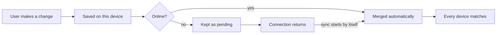

# SyncScribe — Product Requirements Document

Nov 14, 2026

## 1. Project overview and vision

SyncScribe is a markdown workspace where people can write, organize and co-edit documents with or without an internet connection, and never lose work or overwrite each other.

### The problem

- Most online editors stop working, or silently fail to save, when the connection drops.
- When two people edit the same document offline, one person's changes usually overwrite the other's, or they must merge versions by hand.
- Users are forced to wait for the network on every keystroke, which makes editing feel slow.

### The vision

The user's device is the primary home of their documents. Every action (typing, creating, renaming, moving, deleting) takes effect instantly on the device. Sharing and syncing with collaborators happens quietly in the background whenever a connection exists. When people reconnect after working apart, all their changes are combined automatically, with no manual merging and no lost words.

### Target users

- Students and academic teams writing notes, reports and theses together.
- Remote and travelling workers with unreliable connectivity (trains, flights, rural areas).
- Small teams that keep shared documentation, meeting notes and wikis.

### Product goals

1. **Always usable:** every editing and organizing feature works with zero connectivity.
2. **Instant:** changes are saved on the device immediately, with no visible wait.
3. **No lost work:** no edit is ever discarded or overwritten during sync.
4. **No manual merging:** concurrent edits from many people combine automatically.
5. **Transparent:** users always know whether they are online, offline, syncing or fully synced.

### Product principles

- The device is the source of truth for the user; the network is an enhancement.
- Saving is automatic; there is no Save button.
- Sync never asks the user to choose between two versions.
- Status is always visible but never intrusive.

## 2. Complete feature list

SyncScribe has 67 features across 10 areas. Priority: **Must** = needed for a working product; **Should** = expected but can follow; **Could** = nice to have.

### A. Accounts and identity

| ID | Feature | Description | Priority |
| --- | --- | --- | --- |
| A1 | Sign up | Create an account with name, email and password. | Must |
| A2 | Sign in / sign out | Access the account; sign-out asks whether to keep or clear local data on this device. | Must |
| A3 | Stay signed in offline | A previously signed-in user can open and use the app with no connection. | Must |
| A4 | Profile | Set display name, avatar initials and a personal cursor colour shown to collaborators. | Should |
| A5 | Password reset | Request a reset link by email (online only). | Should |
| A6 | Multiple devices | The same account can be used on several devices; all stay in sync. | Should |

### B. Workspace and organization

| ID | Feature | Description | Priority |
| --- | --- | --- | --- |
| B1 | Personal workspace | Every user gets a private workspace on sign-up. | Must |
| B2 | Shared workspaces | Create a team workspace and invite members. | Should |
| B3 | Folders | Create, rename, nest and delete folders. | Must |
| B4 | Document list / sidebar | Tree view of folders and documents with expand/collapse. | Must |
| B5 | Move documents | Drag and drop documents and folders between folders. | Must |
| B6 | Sort and filter | Sort by name, last edited, created; filter by tag or owner. | Should |
| B7 | Tags | Add, remove and filter by tags on documents. | Could |
| B8 | Favourites / pin | Pin important documents to the top of the sidebar. | Could |
| B9 | Recent documents | Quick list of recently opened documents. | Should |
| B10 | Trash | Deleted items go to Trash; restore or permanently delete; auto-empty after 30 days. | Must |

### C. Document editing

| ID | Feature | Description | Priority |
| --- | --- | --- | --- |
| C1 | Create document | New blank document, or from a template, opens instantly. | Must |
| C2 | Markdown editor | Write in markdown: headings, bold, italic, lists, task lists, links, quotes, code blocks, tables, horizontal rules. | Must |
| C3 | Live preview | Edit-only, preview-only and side-by-side modes. | Must |
| C4 | Formatting toolbar | Buttons for common markdown formatting for users who don't know the syntax. | Should |
| C5 | Keyboard shortcuts | Shortcuts for formatting, save-status, search, new document. | Should |
| C6 | Auto-save | Every change is saved to the device immediately; no Save button. | Must |
| C7 | Undo / redo | Undo and redo the user's own changes, unaffected by others' edits. | Must |
| C8 | Rename document | Edit the title inline. | Must |
| C9 | Duplicate document | Make a copy as a new independent document. | Could |
| C10 | Images | Insert images by paste, drag-drop or upload; stored with the document and available offline. | Should |
| C11 | Find and replace | Within the open document. | Should |
| C12 | Word count and reading time | Shown in the status bar. | Could |
| C13 | Table of contents | Generated from headings; click to jump. | Could |
| C14 | Templates | Built-in templates (meeting notes, report, to-do) and save-as-template. | Could |
| C15 | Focus mode / themes | Distraction-free mode; light and dark themes. | Could |

### D. Offline operation

| ID | Feature | Description | Priority |
| --- | --- | --- | --- |
| D1 | Full offline use | Every feature in B, C, F and H works without a connection. | Must |
| D2 | App loads offline | The app opens from the device after the first visit, with no connection. | Must |
| D3 | Local persistence | All documents, folders and pending changes survive closing the tab, the browser or restarting the device. | Must |
| D4 | Pending changes queue | Changes made offline are tracked and kept until synced. | Must |
| D5 | Installable app | Users can install SyncScribe to their home screen or desktop. | Should |
| D6 | Offline availability indicator | Shows which shared documents are fully downloaded and available offline. | Should |
| D7 | Storage usage | Shows how much device storage SyncScribe uses; warns when space is low. | Should |

### E. Sync and conflict-free merging

| ID | Feature | Description | Priority |
| --- | --- | --- | --- |
| E1 | Network detection | Detect going offline and coming back online automatically. | Must |
| E2 | Automatic background sync | On reconnect, pending changes upload and remote changes download without user action. | Must |
| E3 | Automatic merge | Concurrent edits from any number of users merge without data loss or a choice dialog. | Must |
| E4 | Consistent result | After sync, every collaborator sees exactly the same document content. | Must |
| E5 | Sync status indicator | Shows Online, Offline, Syncing, Synced, or Sync error, globally and per document. | Must |
| E6 | Pending change count | Shows how many documents have unsynced changes. | Should |
| E7 | Manual "Sync now" | A button to retry sync immediately. | Should |
| E8 | Sync while closed | Sync continues in the background briefly after the tab closes, where the device allows. | Could |
| E9 | Structural merge | Concurrent renames, moves and deletes of documents and folders are also resolved automatically. | Must |

### F. Real-time collaboration

| ID | Feature | Description | Priority |
| --- | --- | --- | --- |
| F1 | Live co-editing | When online, collaborators see each other's typing within about a second. | Must |
| F2 | Presence | Avatars of who is viewing the document right now. | Should |
| F3 | Live cursors and selections | Each collaborator's cursor and selection in their colour with their name. | Should |
| F4 | Comments | Comment on selected text; reply, resolve, reopen; works offline and syncs. | Could |
| F5 | Mentions | @mention a collaborator in a comment to notify them. | Could |

### G. Sharing and permissions

| ID | Feature | Description | Priority |
| --- | --- | --- | --- |
| G1 | Share document | Invite people by email to a document or folder. | Must |
| G2 | Roles | Owner, Editor, Commenter, Viewer. | Must |
| G3 | Share link | Create a link with a chosen role; revoke it at any time. | Should |
| G4 | Manage access | See who has access, change roles, remove people. | Must |
| G5 | Read-only enforcement | Viewers cannot edit, even offline; their local edits are never accepted. | Must |

### H. Version history

| ID | Feature | Description | Priority |
| --- | --- | --- | --- |
| H1 | Version history | Browse past versions of a document with time and author. | Should |
| H2 | Change attribution | Highlight who wrote which text in a version. | Could |
| H3 | Restore version | Restore an earlier version (as a new change, so nothing is lost). | Should |
| H4 | Named versions | Name a version, for example "Submitted draft". | Could |

### I. Search

| ID | Feature | Description | Priority |
| --- | --- | --- | --- |
| I1 | Full-text search | Search titles and content of all local documents, offline. | Must |
| I2 | Quick open | Jump to a document by typing part of its name. | Should |

### J. Import, export and notifications

| ID | Feature | Description | Priority |
| --- | --- | --- | --- |
| J1 | Import | Import .md and .txt files as new documents. | Should |
| J2 | Export | Export a document as Markdown, HTML or PDF; export a whole workspace as a zip. | Should |
| J3 | In-app notifications | Notices for: shared with you, mentioned, sync finished, sync failed, access removed. | Should |
| J4 | Onboarding | A short first-run guide and a welcome document explaining offline use. | Could |

## 3. User roles and personas

Four document roles control what a person can do; the same person can hold different roles on different documents.

| Role | Can view | Can comment | Can edit content | Can share / change access | Can delete permanently |
| --- | --- | --- | --- | --- | --- |
| Owner | Yes | Yes | Yes | Yes | Yes |
| Editor | Yes | Yes | Yes | Invite only, up to Editor | No (Trash only) |
| Commenter | Yes | Yes | No | No | No |
| Viewer | Yes | No | No | No | No |

### Personas

- **Priya, student group lead** — writes a group report with three classmates, often on the bus with no signal. Needs everyone's edits to come together before the deadline without anyone's section disappearing.
- **Marco, field researcher** — spends days offline at remote sites, recording notes. Needs everything saved safely and shared with the team the moment he gets signal.
- **Lena, team documentation owner** — maintains a shared wiki for a 10-person team. Needs folders, permissions, search and version history to keep it organized and recover from mistakes.

## 4. User stories and workflows

Each story names the features it covers and ends with acceptance criteria a tester can check.

### 4.1 User stories

| ID | As a… | I want to… | So that… | Features |
| --- | --- | --- | --- | --- |
| US1 | new user | sign up and land in a ready workspace | I can start writing in under a minute | A1, B1, J4 |
| US2 | user | open the app with no connection | I can keep working anywhere | A3, D1, D2 |
| US3 | writer | type and have every change kept automatically | I never lose work if the tab or device closes | C6, D3 |
| US4 | writer | format text with markdown or a toolbar and see a preview | my document looks right | C2, C3, C4 |
| US5 | organizer | create folders and move documents between them, even offline | my workspace stays tidy | B3, B4, B5 |
| US6 | user | see clearly whether I am online, offline, syncing or synced | I know whether others have my changes | E5, E6 |
| US7 | offline writer | have my offline changes sent automatically when I reconnect | I don't have to remember to sync | D4, E1, E2 |
| US8 | collaborator | edit the same document as a teammate while both offline | both our changes survive and combine | E3, E4 |
| US9 | collaborator | see teammates' cursors and typing live when online | we can write together without stepping on each other | F1, F2, F3 |
| US10 | owner | invite people with a specific role | I control who can change my document | G1, G2, G4 |
| US11 | viewer | read a shared document offline | I can review it anywhere without risk of changing it | G5, D6 |
| US12 | user | restore an earlier version | I can undo a mistake by anyone | H1, H3 |
| US13 | user | search across all my documents offline | I find information fast | I1, I2 |
| US14 | user | recover a deleted document from Trash | accidental deletes are not permanent | B10 |
| US15 | user | export my document as Markdown, HTML or PDF | I can submit or share it outside the app | J2 |
| US16 | reviewer | comment on text and resolve comments | feedback stays next to the content | F4, F5 |
| US17 | user on several devices | see the same documents on laptop and phone | I can switch devices freely | A6, E2 |

### 4.2 Workflow: first-time sign-up and onboarding

1. User opens SyncScribe and selects Sign up.
2. User enters name, email and password; the system validates them (valid email, password at least 8 characters).
3. Account is created; a personal workspace and a Welcome document are created.
4. The app is stored on the device so it can open offline next time; a brief tip explains this.
5. The Welcome document opens in the editor.

Acceptance: after one online visit, closing the browser, going offline and reopening shows the workspace and the Welcome document.

### 4.3 Workflow: creating and editing a document (online or offline)

1. User selects New document (sidebar, shortcut, or a template).
2. A document titled "Untitled" is created instantly in the current folder and opens with the cursor in the title.
3. User types a title, then writes content in markdown.
4. Every keystroke is saved on the device immediately; the status shows "Saved on this device".
5. If online, the change is also sent to collaborators and the status moves Syncing → Synced.
6. If offline, the document is marked as having pending changes; the status shows "Offline — changes saved on this device".
7. User can switch between edit, preview and side-by-side at any time.

Acceptance: closing the tab mid-sentence and reopening shows the text exactly as typed, online or offline.

### 4.4 Workflow: going offline and reconnecting

1. User is editing while online; status shows Synced.
2. The connection drops. Within a few seconds the status changes to Offline and a non-blocking notice says work will be saved and synced later.
3. User keeps editing, creates new documents, renames and moves items. Each item with unsynced changes shows a small pending marker.
4. The connection returns. Status changes to Syncing automatically.
5. All pending changes upload; any changes collaborators made meanwhile download.
6. Changes are merged automatically; the open document updates in place without moving the user's cursor or losing their selection.
7. Status changes to Synced; pending markers disappear; a brief notice confirms "All changes synced".

Acceptance: no user action is needed at any step after the connection returns.

### 4.5 Workflow: two people editing the same document while offline

1. Priya and Ali both have "Group Report" on their devices.
2. Both go offline. Priya rewrites the Introduction; Ali adds a new Conclusion and fixes a typo in the Introduction.
3. Priya reconnects first; her changes sync.
4. Ali reconnects; his changes sync and merge with Priya's.
5. Both now see the identical document: Priya's new Introduction (with Ali's typo fix applied wherever that text still exists), and Ali's Conclusion.
6. If both typed in the exact same spot, both pieces of text are kept, side by side, in a consistent order for everyone; neither is deleted.
7. Version history shows each person's contribution.

Acceptance: no text from either user is lost; both users end with byte-for-byte identical content; no dialog asks either user to choose.

### 4.6 Workflow: real-time co-editing

1. Two or more collaborators open the same document while online.
2. Presence avatars show who is there.
3. Each sees others' cursors labelled with names and colours.
4. Typing appears for others within about one second.
5. If one person drops offline mid-session, their avatar shows as offline; their later edits merge when they return (workflow 4.4).

### 4.7 Workflow: organizing documents

1. User creates a folder from the sidebar and names it.
2. User drags documents into it, or uses Move to… from the document menu.
3. User renames or nests folders.
4. All of this works offline; structure changes sync like content.
5. If two people move the same document to different folders while offline, it ends up in one folder, chosen the same way for everyone, and is never duplicated or lost.

### 4.8 Workflow: sharing and permissions

1. Owner opens Share on a document or folder.
2. Owner enters an email and picks a role (Editor, Commenter, Viewer), or creates a share link with a role.
3. Invitee receives a notification/email; on accepting, the document appears in their "Shared with me" list and downloads to their device.
4. Owner can change roles or remove access at any time from Manage access.
5. When a person's access is removed, the document disappears from their sidebar at their next sync; their unsynced edits are not accepted and they are told why.

Sharing requires a connection; if offline, the Share action explains that invitations will be sent when back online (queued) or asks the user to reconnect.

### 4.9 Workflow: version history and restore

1. User opens History on a document.
2. A timeline lists versions with time and author(s); named versions are highlighted.
3. Selecting a version shows its content, optionally with changes highlighted by author.
4. User selects Restore; the document returns to that content as a new change on top of history, so the current version remains recoverable.
5. Collaborators receive the restored content via normal sync.

### 4.10 Workflow: delete and restore from Trash

1. User deletes a document or folder; it moves to Trash (works offline).
2. Collaborators see it disappear at next sync; owners see it in their Trash.
3. From Trash the user can Restore (to its original folder, or to the workspace root if that folder no longer exists) or Delete permanently (Owner only, confirmation required).
4. Items in Trash for 30 days are deleted permanently.

### 4.11 Workflow: search

1. User opens search (shortcut or search box).
2. Results from titles and content of all documents on the device appear as the user types, with matching text highlighted.
3. Selecting a result opens the document at the match.
4. Search works fully offline.

### 4.12 Workflow: import and export

1. Import: user selects Import, picks .md or .txt files; each becomes a new document in the current folder.
2. Export: user opens a document's menu, picks Export and a format (Markdown, HTML, PDF); the file downloads.
3. Workspace export produces a zip of all documents as markdown files in their folder structure.
4. Import and export work offline.

## 5. Data flows

All data is written to the user's device first; it only moves between devices through background sync, and every device converges on the same result.

Offline, changes wait on the device as pending; when the connection returns, sync starts on its own and merges them with everyone else's. Collaborators' changes arrive the same way, and the open document updates in place.

### 5.1 Data the product handles

| Data | Where it lives | Who can see it |
| --- | --- | --- |
| Account and profile (name, email, colour) | Sync service; cached on each signed-in device | The user; name and colour visible to collaborators |
| Workspaces, folders and document tree | Every member's device + sync service | Workspace members |
| Document content (text, images) | Every device with access + sync service | People with access to that document |
| Change history (who changed what, when) | Every device with access + sync service | People with access; shown in Version history |
| Pending changes | Only the device that made them, until synced | The user |
| Permissions and share links | Sync service; copied to devices | Owner can manage; others see their own role |
| Comments and mentions | Every device with access + sync service | People with access (Commenter and above) |
| Presence (who's here, cursors) | Live only, never stored | Others currently in the document |
| Notifications | Sync service + recipient's devices | The recipient |

### 5.2 Flows: trigger → what moves → result

| ID | Trigger | Data that moves | From → To | Result |
| --- | --- | --- | --- | --- |
| DF1 | User types or formats | The change | Editor → device storage | Saved instantly; status "Saved on this device". |
| DF2 | A change is saved while online | The change | Device → sync service → collaborators' devices | Collaborators see it in about a second; status "Synced". |
| DF3 | A change is saved while offline | The change | Device storage → pending changes list | Item marked pending; pending count increases. |
| DF4 | Connection lost | Network state | Device → status indicator | Status "Offline"; non-blocking notice. |
| DF5 | Connection returns | All pending changes | Device → sync service | Status "Syncing"; pending list empties as each is confirmed. |
| DF6 | Sync service has changes from others | Collaborators' changes | Sync service → device | Merged into local documents; open document updates in place. |
| DF7 | Two devices changed the same document | Both sets of changes | Each device ↔ sync service | Automatic merge; all devices end identical. |
| DF8 | User creates, renames, moves or deletes an item | Structure change | Device → (sync) → other members' devices | Sidebar updates everywhere. |
| DF9 | User opens a document | Presence | Device → others in the document (live) | Avatars and cursors appear. |
| DF10 | Owner shares a document | Invitation + permission | Device → sync service → invitee | Notification; document downloads to invitee's device. |
| DF11 | Access removed or role lowered | Permission change | Sync service → affected device | Document removed or made read-only; their later edits refused. |
| DF12 | User restores a version | Past content as a new change | Device → sync → collaborators | Everyone sees the restored content; history kept. |
| DF13 | User signs in on a new device | All documents they can access | Sync service → new device | Workspace becomes available offline on that device. |
| DF14 | User searches | Search text | Device only | Results from local documents; nothing leaves the device. |
| DF15 | User exports | Document content | Device → downloaded file | File saved on the user's computer. |
| DF16 | Same document open in two tabs | The change | Tab → other tab on the same device | Both tabs stay identical, even offline. |

## 6. Edge cases and error scenarios

The rule behind every case below: never lose a user's words, never block editing, and always tell the user what happened in plain language.

### 6.1 Connectivity

| ID | Scenario | Expected behaviour |
| --- | --- | --- |
| EC1 | Connection drops mid-sync | Partially sent changes are not lost; sync resumes from where it stopped on reconnect; nothing is applied twice. |
| EC2 | Flaky connection (on/off repeatedly) | Status does not flicker; the app waits a few seconds before declaring Offline and retries with increasing delays. |
| EC3 | Device reports "online" but the server is unreachable (captive Wi-Fi, server down) | App treats it as offline, shows "Can't reach SyncScribe — working offline", and keeps retrying. |
| EC4 | First visit with no connection | App cannot load; a clear message asks the user to connect once to set up offline use. |
| EC5 | User offline for weeks with many changes | All changes are kept and sync on return; a progress indicator shows for large syncs. |
| EC6 | Very slow connection | Editing stays instant; sync runs in the background; status shows Syncing until done. |

### 6.2 Concurrent editing and merging

| ID | Scenario | Expected behaviour |
| --- | --- | --- |
| EC7 | Two users type at the exact same position | Both insertions are kept, in the same order for everyone. |
| EC8 | One user deletes a paragraph while another edits inside it | The deletion and the edit both apply; the other user's newly typed text survives where the paragraph was. Version history allows recovery of the deleted text. |
| EC9 | One user deletes a document while another edits it offline | The document is moved to Trash, not erased; the editor's changes are kept in it; the editor is told "This document was deleted by [name]" and can restore it. |
| EC10 | Two users rename the same document differently | One title wins, chosen the same way on every device; the other title is visible in version history. |
| EC11 | Two users move the same item to different folders | It ends up in exactly one folder, the same for everyone; never duplicated or lost. |
| EC12 | User A moves folder X into folder Y while user B moves Y into X | No loop is created; one move is applied and the other is undone consistently; the affected users are notified. |
| EC13 | A user edits a document inside a folder another user deleted | The folder and document are restored from Trash so the edit is not lost, or the document is moved to the workspace root; the user is notified. |
| EC14 | Undo after remote changes arrived | Undo reverses only the user's own last change, never a collaborator's. |
| EC15 | Many collaborators (e.g. 20) editing at once | All edits merge; live updates may slow slightly but no content is lost. |

### 6.3 Permissions and accounts

| ID | Scenario | Expected behaviour |
| --- | --- | --- |
| EC16 | User's access is removed while they are offline and editing | On reconnect, their changes to that document are not accepted; they are told access was removed and offered an export of their local copy. |
| EC17 | User is downgraded from Editor to Viewer while offline | Same as EC16 for changes made after the downgrade; the document becomes read-only on their device. |
| EC18 | Viewer attempts to edit (including offline) | Editor is read-only; no local edits are possible. |
| EC19 | Session expires while offline | User keeps working offline; on reconnect they are asked to sign in again; pending changes sync after sign-in, never discarded. |
| EC20 | User signs out with unsynced changes | A warning lists unsynced documents and offers: sync first, sign out anyway (keep data on device), or cancel. |
| EC21 | A different user signs in on a shared device | They never see the previous user's local documents. |
| EC22 | Invitation sent to an email with no account | Invitee is asked to sign up; the document appears once they do. |
| EC23 | Share link revoked | Anyone opening it sees "This link is no longer active". |

### 6.4 Device and storage

| ID | Scenario | Expected behaviour |
| --- | --- | --- |
| EC24 | Device storage nearly full | Warning shows usage and suggests removing offline copies of rarely used shared documents or large images. Editing of text continues as long as possible. |
| EC25 | Device storage full | New images are refused with a clear message; text edits are kept in memory and the user is urged to free space or reconnect to sync. |
| EC26 | Browser data cleared by user or browser | Synced content is downloaded again on next sign-in; the user is warned beforehand (in onboarding and settings) that unsynced offline changes would be lost. |
| EC27 | Private / incognito browsing | User is warned that offline data will be lost when the window closes. |
| EC28 | Same document open in two tabs on one device | Both tabs stay in sync with each other instantly, even offline. |
| EC29 | Browser or device crashes mid-edit | On reopen, all text up to the last keystroke or so is present. |
| EC30 | App update released while user is offline | The current version keeps working; the update installs on next online launch; existing local data remains readable. |

### 6.5 Content and input

| ID | Scenario | Expected behaviour |
| --- | --- | --- |
| EC31 | Very large document (e.g. 100,000 words) | Editing remains responsive; preview may update with a short delay. |
| EC32 | Pasting a very large block of text | Paste completes; if over a size limit, the user is told the limit. |
| EC33 | Invalid or broken markdown | Raw text is always kept; preview shows best-effort rendering, never an error page. |
| EC34 | Image too large or unsupported type | Clear message with allowed types and maximum size. |
| EC35 | Import of a non-text or corrupted file | Rejected with a message naming the file; other files in the batch still import. |
| EC36 | Empty or duplicate document titles | Allowed; empty titles display as "Untitled". |
| EC37 | Script or unsafe content pasted into markdown | Preview never runs it; it is shown as text. |
| EC38 | Export to PDF while offline | Works; any image not on the device shows a placeholder. |

### 6.6 System errors

| ID | Scenario | Expected behaviour |
| --- | --- | --- |
| EC39 | Sync rejected by the server repeatedly | Status shows Sync error with a plain reason and a Retry button; local changes stay safe on the device. |
| EC40 | Local storage unavailable or blocked | App explains that offline mode cannot work in this browser setting and runs in online-only mode. |
| EC41 | Device clock is wrong | Merging still produces the correct, identical result for everyone; only displayed timestamps may look off. |

## 7. Out of scope and glossary

### Out of scope for this version

- Rich-text (WYSIWYG) editing that is not markdown-based.
- Spreadsheets, slides, or drawing canvases.
- Video or voice calls and chat between collaborators.
- Public publishing of documents as websites.
- Third-party integrations (cloud drives, chat apps).
- End-to-end encryption and enterprise admin features (single sign-on, audit logs).

### Glossary

| Term | Meaning in this product |
| --- | --- |
| Local-first | Documents live on the user's device first; the app works fully without a network and syncs when one is available. |
| Offline | The device cannot reach SyncScribe's sync service, for any reason. |
| Pending change | An edit saved on the device but not yet received by the sync service. |
| Sync | Sending pending changes out and receiving collaborators' changes in. |
| Concurrent edit | Two or more people changing the same document before seeing each other's changes. |
| Automatic merge | Combining concurrent edits so that every change is kept and every device ends with the same result, without asking the user. |
| CRDT | Conflict-free Replicated Data Type: the kind of data model that makes automatic merge possible. |
| Presence | Showing who is currently viewing a document and where their cursor is. |
| Workspace | A container of folders and documents, either personal or shared with a team. |
