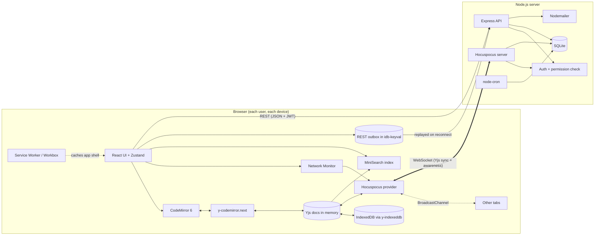

# SyncScribe — Tools & Technologies

Companion to `SyncScribe-PRD.md`. This is the technical stack bible: every tool, its role, why it was chosen over alternatives, and how the tools connect.

**Cost rule:** every tool below is free and open source (or has a free tier that fully covers this project). Total cost: **$0**.

---

## 1. Stack at a glance

| Layer | Tool | Role | Licence / cost |
| --- | --- | --- | --- |
| Language | TypeScript | One typed language for client, server and shared code | Apache-2.0, free |
| Repo layout | npm workspaces (monorepo) | `apps/web`, `apps/server`, `packages/shared` in one repo | Free (built into npm) |
| Frontend framework | React 18 | UI components and screens | MIT, free |
| Build tool / dev server | Vite | Fast dev server, production build, PWA plugin host | MIT, free |
| Routing | React Router | Screen navigation (`/doc/:id`, `/trash`, `/login`…) | MIT, free |
| UI state | Zustand | Small global stores (session, network status, UI prefs) | MIT, free |
| Styling | Tailwind CSS | Utility-first styling, light/dark themes | MIT, free |
| Icons | lucide-react | Icon set | ISC, free |
| CRDT engine | **Yjs** | Conflict-free merge of document text, tree structure, comments | MIT, free |
| Markdown editor | CodeMirror 6 + `@codemirror/lang-markdown` | Text editor with markdown syntax, search, keymaps | MIT, free |
| Editor ↔ CRDT binding | `y-codemirror.next` | Binds CodeMirror to `Y.Text`; live cursors; CRDT-aware undo | MIT, free |
| Local persistence | `y-indexeddb` (IndexedDB) | Stores every Yjs document on the device | MIT, free |
| Small local stores | `idb-keyval` (IndexedDB) | Session cache, pending flags, REST outbox, settings | Apache-2.0, free |
| Offline app shell | `vite-plugin-pwa` (Workbox Service Worker) | Precache app so it loads offline; install prompt; update flow | MIT, free |
| Sync client | `@hocuspocus/provider` | WebSocket sync of Yjs docs, multiplexed, auto-reconnect, cross-tab broadcast | MIT, free |
| Presence | Yjs Awareness (built into provider) | Who's online, cursors, selections | MIT, free |
| Markdown preview | `react-markdown` + `remark-gfm` + `rehype-sanitize` | Render GFM markdown safely (tables, task lists) | MIT, free |
| Code highlighting in preview | `rehype-highlight` | Syntax colours in code blocks | MIT, free |
| Full-text search | MiniSearch | In-browser, offline full-text index | MIT, free |
| Export | JSZip + `file-saver` + browser print | Zip workspace export, file downloads, PDF via "Save as PDF" | MIT, free |
| Validation | Zod | Shared request/response schemas (client + server) | MIT, free |
| Backend runtime | Node.js 20 LTS | Runs the sync and API server | MIT, free |
| HTTP API | Express | REST endpoints: auth, sharing, versions, notifications | MIT, free |
| Sync server | **Hocuspocus server** (`@hocuspocus/server`) | Yjs WebSocket server with auth hooks, read-only connections, persistence hooks | MIT, free |
| Database | SQLite via `better-sqlite3` | Users, permissions, document state, versions, notifications — one file | Public domain / MIT, free |
| Passwords | `bcryptjs` | Password hashing | MIT, free |
| Tokens | `jose` (JWT) | Signed access tokens for REST and WebSocket auth | MIT, free |
| Email (dev) | Nodemailer + Ethereal test inbox / console log | Password reset and invitation emails without a paid email service | MIT, free |
| Scheduled jobs | `node-cron` | Daily Trash purge (30 days) | ISC, free |
| Unit tests | Vitest | Unit tests for CRDT logic, tree resolution, stores, API | MIT, free |
| E2E tests | Playwright | Browser tests incl. offline emulation and two-user merge | Apache-2.0, free |
| Lint / format | ESLint + Prettier | Code quality | MIT, free |
| Version control | Git + GitHub | Source control, submission | Free |
| Editor | VS Code | Development | Free |
| Hosting (optional) | Netlify / Vercel (frontend), Render free web service (backend) | Public demo URL | Free tiers |

---

## 2. Each tool: role, why it was chosen, and the free justification

### 2.1 Core language and project setup

**TypeScript**
- *Role:* all code — React app, Node server, shared types (`packages/shared`).
- *Why:* the sync protocol, permission roles and data models are shared between client and server; one set of types prevents mismatches. Catches bugs early, which matters on a 2-day deadline.
- *Alternatives rejected:* plain JavaScript (no type safety across the client/server boundary).

**npm workspaces (monorepo)**
- *Role:* one repo with `apps/web`, `apps/server`, `packages/shared`; one `npm install`.
- *Why:* zero extra tooling; shared Zod schemas and types are imported directly.
- *Alternatives rejected:* Turborepo / Nx (extra setup not needed for 3 packages); pnpm (fine, but npm is already installed everywhere).

### 2.2 Frontend

**React 18**
- *Role:* all screens and components.
- *Why:* largest ecosystem; the editor (CodeMirror) and markdown renderer have mature React integrations; widely understood by examiners.
- *Alternatives rejected:* Vue / Svelte (equally capable, smaller ecosystem for Yjs examples); Next.js (server rendering adds nothing to a local-first app and complicates offline caching).

**Vite**
- *Role:* dev server with hot reload, production bundling, hosts the PWA plugin.
- *Why:* fastest setup; first-class `vite-plugin-pwa` support for the Service Worker.
- *Alternatives rejected:* Create React App (deprecated); Webpack (slow, verbose config).

**React Router** — screen routing (`/`, `/doc/:docId`, `/trash`, `/shared`, `/settings`, `/login`, `/signup`, `/s/:token`). Standard choice; works fully client-side, so it works offline.

**Zustand** — small stores for session, network/sync status, UI preferences. Chosen over Redux (too much boilerplate) and React Context alone (re-render issues for frequently changing sync status). Note: document data itself is **not** in Zustand — it lives in Yjs.

**Tailwind CSS + lucide-react** — fast styling with built-in dark mode (`dark:` classes) for C15; consistent icons. Chosen over component kits (MUI, Chakra) which are heavier and harder to make look custom.

### 2.3 Local-first and CRDT layer (the heart of the project)

**Yjs (CRDT)**
- *Role:* every piece of shared data is a Yjs document:
  - each document's text (`Y.Text`), title and images,
  - each workspace's folder/document tree (`Y.Map`),
  - each document's comments,
  - each user's preferences (pins, recents, theme).
- *Why:*
  - Merges concurrent edits automatically with no conflicts and identical results on every device (PRD goals 3–4, E3, E4, E9).
  - Uses logical clocks, not wall-clock time, so a wrong device clock cannot corrupt merges (EC41).
  - Fastest and most widely used JavaScript CRDT; ready-made bindings for CodeMirror, IndexedDB, WebSockets and presence.
  - Built-in `UndoManager` that only undoes the local user's changes (C7, EC14).
- *Alternatives rejected:*
  - **Automerge** — excellent, but larger bundle, slower on big text, fewer editor bindings.
  - **Operational Transformation (ShareDB)** — needs a central server to order every operation, so it cannot merge offline edits as cleanly.
  - **Last-write-wins / manual merge** — violates "no lost work".

**y-indexeddb (IndexedDB)**
- *Role:* persists every Yjs document on the device; loads instantly on startup with no network (D1, D3, C6).
- *Why:* official Yjs persistence provider; IndexedDB is the only browser store large enough (hundreds of MB) and asynchronous.
- *Alternatives rejected:* localStorage (5 MB limit, synchronous, strings only); OPFS (newer, less support, no Yjs adapter).

**idb-keyval** — tiny key-value wrapper over IndexedDB for non-CRDT local data: cached session/profile (A3), per-document pending flags (D4, E6), the REST action outbox (queued invites and mentions while offline), settings. Chosen over Dexie because we need only key-value access (Dexie is fine but heavier than required).

**vite-plugin-pwa (Workbox Service Worker)**
- *Role:*
  - Precaches the app shell (HTML, JS, CSS, fonts, icons) so the app opens with zero connectivity after the first visit (D2, EC4).
  - Web App Manifest so users can install SyncScribe (D5).
  - "New version available" update prompt; old version keeps working offline (EC30).
- *Why:* generates a correct Service Worker from Vite config; hand-writing one is error-prone.
- *Note on network monitoring:* the PRD's "background architecture monitoring network state" is implemented as a **Network Monitor module** in the app (browser `online`/`offline` events + WebSocket status + a health-check ping) working alongside the Service Worker. Service Workers cannot keep a WebSocket open, so live sync stays in the page; the Service Worker handles offline loading and caching.

### 2.4 Sync and collaboration

**Hocuspocus (server + provider)**
- *Role:*
  - Server: accepts WebSocket connections, runs the Yjs sync protocol, authenticates each connection, marks Viewer/Commenter connections **read-only** (server ignores their edits — G5, EC17, EC18), persists document state to SQLite, triggers version snapshots.
  - Provider (client): connects each Yjs doc to the server over **one multiplexed WebSocket**, auto-reconnects with backoff (EC2), reports `synced` / `unsyncedChanges` (E5, E6), and broadcasts between tabs on the same device via BroadcastChannel (EC28).
  - Awareness: presence avatars and live cursors (F2, F3).
- *Why over alternatives:*
  - **y-websocket** (plain server): no built-in authentication hooks, read-only mode, or persistence extensions — we would rebuild them.
  - **Liveblocks / PartyKit / Y-Sweet cloud** — hosted services with usage limits or paid tiers; violates the zero-cost rule and hides the sync logic the project is meant to demonstrate.
  - **Firebase / Supabase Realtime** — not CRDT-based; offline merges become last-write-wins.
- *Free justification:* MIT-licensed, self-hosted on our own Node server.

**react-markdown + remark-gfm + rehype-sanitize + rehype-highlight**
- *Role:* live preview (C3) with GitHub-flavoured markdown (tables, task lists, strikethrough). `rehype-sanitize` strips scripts and unsafe HTML (EC37). Broken markdown still renders best-effort (EC33).
- *Alternatives rejected:* `marked` + DOMPurify (works, but manual HTML injection); `markdown-it` (good, but React integration is less clean).

**MiniSearch**
- *Role:* full-text search over titles and content of all local documents, entirely offline (I1, I2, DF14).
- *Why:* small, fast, fuzzy and prefix search, runs in the browser.
- *Alternatives rejected:* Lunr (cannot update the index incrementally); FlexSearch (faster, but more complex API); server-side search (fails offline).

**JSZip + file-saver + browser print**
- *Role:* Markdown and HTML export as file downloads; workspace export as a zip preserving folders (J2); PDF via a print stylesheet and the browser's built-in "Save as PDF" — works offline (EC38).
- *Alternatives rejected:* jsPDF / Puppeteer (heavier; Puppeteer needs a server). The browser's print engine is free and already present.

### 2.5 Backend

**Node.js 20 LTS + Express**
- *Role:* one server process hosts both the REST API (Express) and the Hocuspocus WebSocket server on the same port.
- *Why:* same language as the frontend; Hocuspocus is a Node library; Express is the most documented HTTP framework.
- *Alternatives rejected:* Fastify (fine, less familiar); NestJS (too much structure for 2 days); Python/Django (second language, no Hocuspocus).

**SQLite via better-sqlite3**
- *Role:* single-file database for users, workspaces, memberships, shares, share links, document state (Yjs binary), versions, notifications, password-reset tokens.
- *Why:* zero setup, no separate database server, fast synchronous API, trivially backed up (copy one file). Hocuspocus stores Yjs state as binary blobs, which SQLite handles well.
- *Alternatives rejected:* PostgreSQL (needs a running server; free hosted tiers expire or sleep); MongoDB Atlas (adds a cloud account and network dependency); Firebase (vendor lock-in, not CRDT).
- *Free justification:* a university demo has a handful of users; SQLite handles thousands of concurrent readers comfortably.

**bcryptjs + jose (JWT)**
- *Role:* hash passwords (A1); issue signed access tokens used by both REST (`Authorization: Bearer`) and WebSocket (`token` field on connect).
- *Why:* pure JavaScript (no native build issues on any laptop); JWTs can be validated without a session table and cached on the device for offline sign-in (A3).
- *Alternatives rejected:* Auth0 / Clerk / Firebase Auth (external accounts, free-tier limits, not usable offline); Passport (unneeded abstraction for email + password).

**Nodemailer + Ethereal / console**
- *Role:* password-reset links (A5) and invitation emails (G1).
- *Why:* Ethereal is a free fake SMTP inbox for development; in demo mode the link is also printed to the server console. No paid email provider needed.
- *Alternatives rejected:* SendGrid / Mailgun / Resend (require accounts; limits); not needed for a demo.

**node-cron** — daily job that permanently deletes items in Trash older than 30 days (B10).

**Zod** — validates every REST request body on the server; the same schemas type the client calls.

### 2.6 Quality and tooling

| Tool | Role | Why free option is enough |
| --- | --- | --- |
| Vitest | Unit tests: tree resolution, cycle-breaking, merge scenarios with two in-memory `Y.Doc`s, permission checks | Same config as Vite; fast |
| Playwright | E2E: offline mode (`context.setOffline(true)`), two browser contexts editing the same doc, reload persistence | Free, runs locally and in GitHub Actions |
| ESLint + Prettier | Consistent code | Industry standard |
| GitHub + GitHub Actions | Repo, submission, CI running tests | Free for public and student repos |
| VS Code | Editor | Free |

### 2.7 Hosting (optional — the demo can run entirely on a laptop)

| Part | Free option | Notes |
| --- | --- | --- |
| Frontend (static files) | Netlify or Vercel free tier, or GitHub Pages | HTTPS included (required for Service Workers outside localhost) |
| Backend (Node + WebSockets) | Render free web service | Supports WebSockets. Sleeps after inactivity (first connection takes ~30–60 s). Disk is ephemeral, so the SQLite file resets on redeploy — acceptable for a demo |
| Local demo | `npm run dev` | Recommended for the presentation: no cold starts, full control of "offline" by stopping the server or using DevTools |

---

## 3. Integration points

| # | From → To | What crosses | Protocol / format |
| --- | --- | --- | --- |
| I1 | CodeMirror ↔ Yjs | Every keystroke becomes a `Y.Text` change; remote changes update the editor without moving the local cursor | `y-codemirror.next` binding |
| I2 | Yjs ↔ IndexedDB | Every Yjs update is appended to IndexedDB immediately; on load, state is restored before any network | `y-indexeddb` |
| I3 | Yjs ↔ Hocuspocus provider | Yjs updates and state vectors; on reconnect, only missing updates are exchanged | Yjs sync protocol over WebSocket |
| I4 | Provider ↔ Hocuspocus server | One multiplexed WebSocket carrying all open docs; JWT sent on connect | WebSocket, binary messages |
| I5 | Hocuspocus server → auth module → SQLite | On connect: verify JWT, look up role; Viewer/Commenter connection set read-only | `onAuthenticate` hook |
| I6 | Hocuspocus server ↔ SQLite | Load document state on first open; store debounced state after changes; write version snapshots | `onLoadDocument` / `onStoreDocument` hooks (SQLite blobs) |
| I7 | React UI ↔ Express | Sign-up/in, sharing, roles, share links, versions list/restore, notifications | HTTPS JSON, `Authorization: Bearer <JWT>` |
| I8 | Network Monitor ↔ provider + UI | `online`/`offline` events, socket status, `/api/health` ping → status store (Online / Offline / Syncing / Synced / Error) | In-app events |
| I9 | Yjs docs → MiniSearch | Document text and title re-indexed after local or remote change (debounced) | In-memory |
| I10 | REST outbox → Express | Actions taken offline that need the server (invites, mentions) replayed in order on reconnect | idb-keyval queue |
| I11 | Service Worker → browser cache | App shell precached at install; served offline; new version prompts update | Workbox |
| I12 | Provider ↔ other tabs | Updates and awareness shared across tabs on the same device, even offline | BroadcastChannel |
| I13 | `packages/shared` → web + server | Types, Zod schemas, role enums, Yjs document key names | TypeScript imports |

---

## 4. Decisions summary (why this combination)

1. **Yjs + IndexedDB + Hocuspocus** is the most proven free stack for local-first collaborative text: all three are designed to work together, so the 2-day deadline goes into features rather than plumbing.
2. **Everything is a CRDT** (text, tree, comments, preferences) so *all* concurrent changes — not just text — merge without dialogs, as the PRD requires.
3. **Server is thin:** it relays and stores CRDT updates and enforces permissions. All editing logic runs on the client, so the app works offline by design.
4. **SQLite + single Node process** keeps deployment to one command and one file.
5. **No paid service anywhere.** Free tiers are optional and only for a public demo URL.
